# AI Photo Editor｜自然語言智慧修圖系統

用文字或語音說出想調整的地方，在 Web 或 Android App 比較結果、切換版本，再接著微調。系統結合 **Flutter、FastAPI、OpenCV 與兩套自動調色模型**，讓修圖過程保有明確參數、保護條件與完整版本來源。

**自動模型是可選工具。** 可以直接修原圖，也能在任何已提交版本上產生 Image-Adaptive 3D LUT 與 ResidualFusion 兩個候選；選擇其中一個續修後，另一個仍會保留。

> 文件整理：2026-10-12。功能基線依已驗收系統與團隊《完整專題研究報告》整理；圖片取自該報告。研究數據與效能數字是既有紀錄，本次文件更新未重新量測。

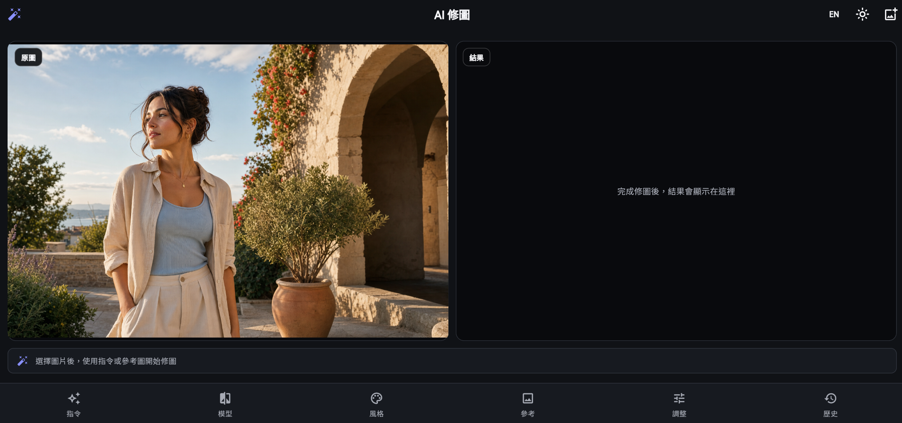

[功能介紹](#features) · [操作畫面](#screenshots) · [使用流程](#workflow) · [研究方法與結果](#research) · [安裝與執行](#run) · [未來研究](#future)

<a id="features"></a>
## 已完成的功能

| 能力 | 可以做什麼 |
| --- | --- |
| 自然語言與連續微調 | 理解中文、英文及常見中英混用；接續「再亮一點」「太亮了，暗一點」等回饋，在同一區域組合最多三項主要微調操作。 |
| 統一指令入口 | 同一個 Prompt 可操作一般修圖、單一精確參數、風格及 Photo Git；支援限定欄位的中文／英文數字、百分比與版本編號正規化。 |
| 本機語音輸入 | Whisper 提供繁中／英文／自動模式，錄音上限 15 秒，可停止或取消；逐字稿可編輯，按下「套用指令」才會修圖。 |
| 15 項手動參數 | 滑桿調整、重設、預覽與正式提交；預覽不直接建立歷史版本。 |
| 五種局部區域 | 天空、人物、背景、亮部、暗部；另可選全圖。找不到指定目標時明確失敗，不改套全圖。 |
| 50 種正式風格 | 分類、預覽與強度控制；保存風格配方、版本及來源，套用後仍能繼續微調。 |
| 參考圖調色 | 以另一張照片的整體平均色彩提供有限強度的色調方向，不複製其物件、構圖或完整質感。 |
| 可選雙模型 | 同一來源產生「專家忠實型」3D LUT 與「鮮明對比型」ResidualFusion 候選，兩個成功結果都保存，可在後續版本重跑。 |
| 歷史與分支 | 保存圖片、指令、參數、作用區域、父版本及模型來源；可回到舊版比較或建立新分支。 |
| Photo Git | 指定來源的修改帶入、分支合併及選擇性撤銷；先分析與預覽，有衝突時由使用者選擇，再提交新版本。 |
| 可驗證修圖合約 | 檢查高光截斷、暗部截斷、保護區域色差及遮罩外溢；必要時縮小幅度，無安全結果時不新增成功版本。 |
| 跨裝置操作 | 圖片優先的響應式工作區、繁中／英文、深色／淺色、原圖／結果／前一版本比較與同步縮放。 |

15 項公開參數為：**曝光、亮度、對比、亮部、暗部、白色、黑色、飽和度、自然飽和度、色溫、色偏、銳化、清晰度、去霧、暗角**。

### 平台狀態

| 平台 | 目前成果與界線 |
| --- | --- |
| Web | `frontend/` 為正式 Flutter Web；已完成桌面與行動瀏覽器流程驗證。 |
| Android App | `mobile_app/` 為獨立 Flutter 原生 App，共用 FastAPI；已完成 release APK 建置、實體手機安裝、區網連線及目前功能操作確認。另有後端連線設定、JPEG／PNG 檢查、結果存相簿及最近工作恢復。 |
| iPhone Safari | 研究報告記錄以 Windows 電腦後端、Flutter Web 及 Caddy HTTPS 反向代理完成單使用者實機操作；屬行動網頁成果。 |
| 原生 iOS | 專案保留 iOS 目錄，但尚未完成 macOS／Xcode 建置、簽章及實機部署。 |

**目前 AI 在電腦後端執行，手機負責操作與顯示。** 尚未完成手機端獨立離線推論、完整跨裝置驗收或多人負載評估。

<a id="screenshots"></a>
## 操作畫面與代表案例

以下為研究報告中的實際操作與結果圖片；可點開查看原尺寸。展示案例用於說明功能，不代表所有照片的品質保證。

### Android 的選圖、指令與結果

| 選取照片 | 文字與語音入口 | 結果與版本提示 |
| --- | --- | --- |
| 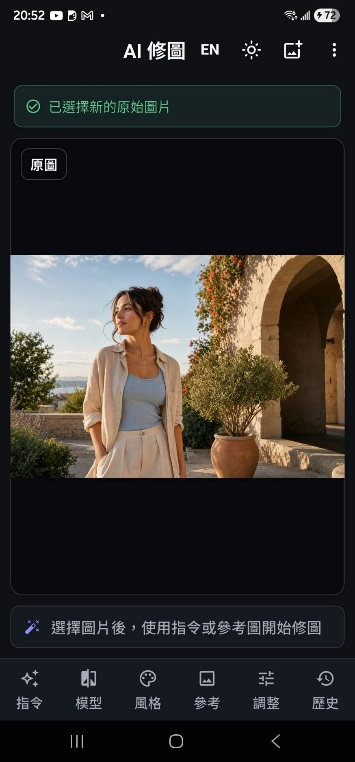 | 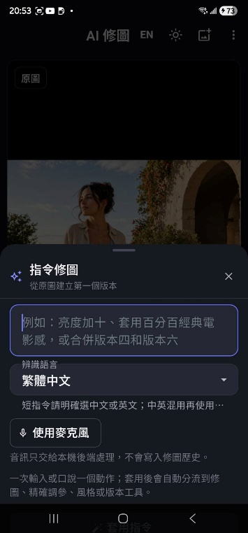 | 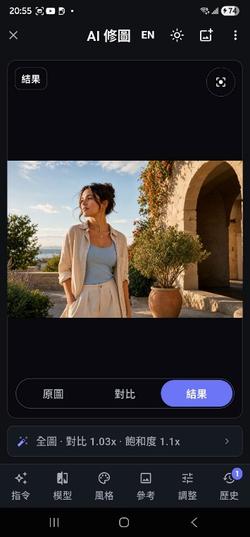 |

### 自然語言連續微調

使用者可沿同一分支持續調整，再以反向回饋修正幅度。下圖依報告順序呈現原圖、調亮後及後續修正結果；歷史面板另記錄每次指令與實際數值。

| 原圖 | 調亮後 | 後續反向修正 |
| --- | --- | --- |
| 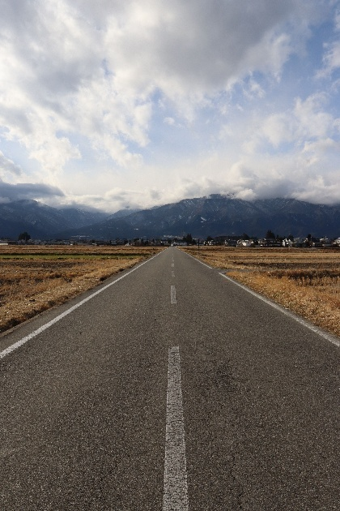 |  | 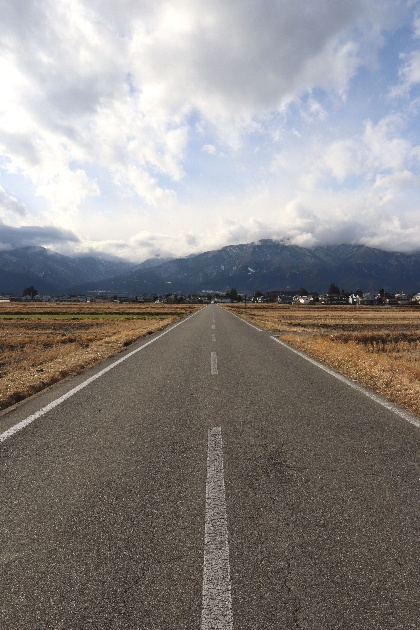 |

### 手動調整與風格強度

手動面板可接續既有版本精調，先查看預覽，再確認套用。

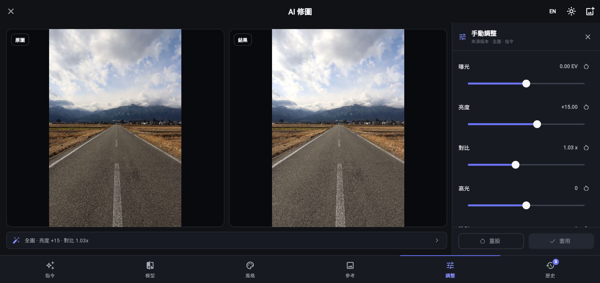

同一張照片套用「雨夜黑色電影」風格，可調整效果強度：

| 原圖 | 50% 強度 | 100% 強度 |
| --- | --- | --- |
|  |  |  |

### Photo Git 與歷史版本

版本操作可選來源、區域與參數，分析後再預覽及提交。歷史面板保留分支、指令與參數摘要。

| 合併與選擇性撤銷入口 | 版本與連續回饋紀錄 |
| --- | --- |
| 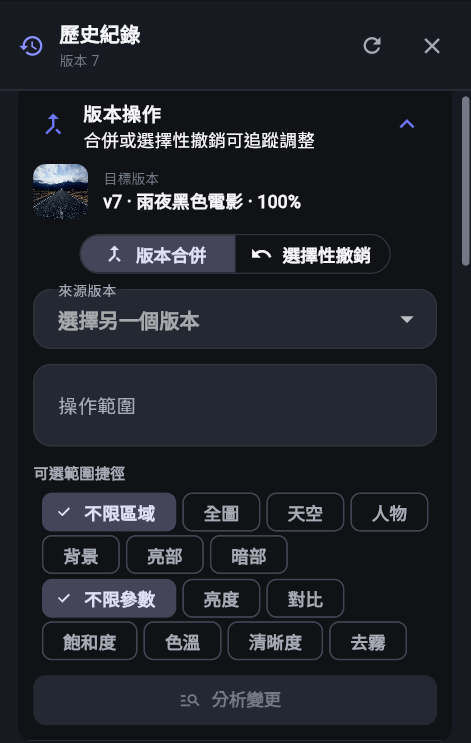 | 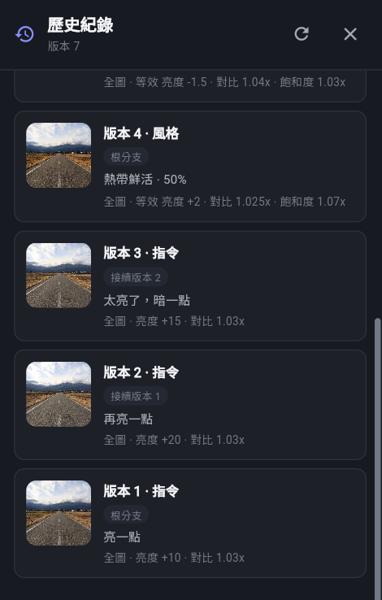 |

### 兩種自動調色模型

每張四格圖依序為：**左上原圖、右上 ResidualFusion、左下 Image-Adaptive 3D LUT、右下 Expert C 參考**。Expert C 僅用於研究比較，實際推論不讀取參考答案。

| 人像案例 | 隧道案例 |
| --- | --- |
| 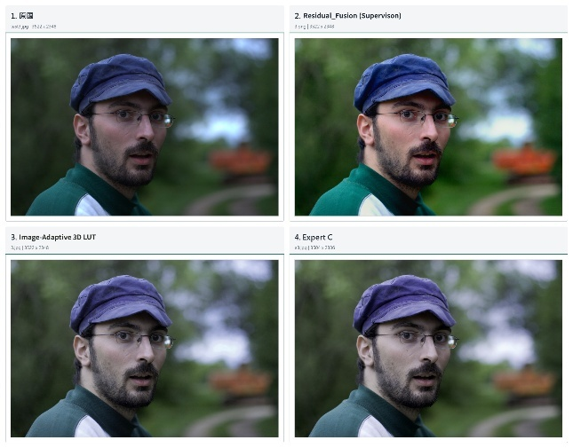 | 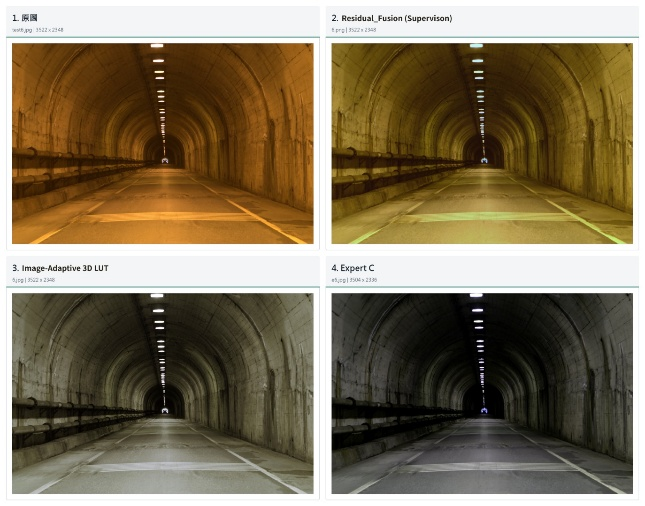 |

報告案例中，ResidualFusion 人像較鮮明，隧道仍帶黃綠色調；3D LUT 色調較接近 Expert C，但隧道較亮。兩種輸出各有特性，團隊保留兩條路線供選擇。「專家忠實／鮮明對比」是功能定位與案例觀察，不是大樣本人類偏好實驗的結論。

<a id="workflow"></a>
## 怎麼使用

1. **選照片**：Web 或 App 匯入原圖，建立工作階段。
2. **選起點**：直接使用指令、手動、風格或參考圖；也可進入「模型」從同一來源產生兩個候選。
3. **持續回饋**：輸入文字，或錄音後修改逐字稿，再按「套用指令」。例如「人物亮一點」「天空降低飽和度」「太亮了，暗一點」。
4. **比較與確認**：比較原圖、結果或前一版本；手動與 Photo Git 使用預覽／提交流程，衝突需明確選擇。
5. **保留分支**：從歷史選回任一版本續修。再次執行模型時，兩個新候選的共同來源會清楚記錄。
6. **儲存成果**：Android 可將目前選定的正式版本存入相簿；最近工作恢復仍需要原電腦後端保留該 session。

可嘗試的指令類型：

| 需求 | 範例與行為 |
| --- | --- |
| 一般微調 | 「再亮一點」「人物稍微亮一點」；沿目前版本調整。 |
| 精確參數 | 「亮度加十」是相對調整；「亮度調到十」是指定值。 |
| 風格 | 「套用百分之五十雨夜黑色電影」；查核正式風格與強度。 |
| 保護條件 | 「天空亮一點，但人物不要變色」；需有可用目標及人物遮罩，通過量測後才保存。 |
| 版本操作 | 指定既有版本帶入修改或撤銷指定步驟；版本不明時澄清，Photo Git 一律先預覽。 |

一次指令只執行一種工具動作。文字與參考圖在同一次操作中互斥；要結合兩者，可先完成參考圖版本，再用文字續修。

<a id="research"></a>
## 研究方法與系統設計

本研究關注三個問題：如何把日常語言轉成可控操作、如何在連續回饋下穩定微調，以及如何保存、比較與重用不同版本的成果。

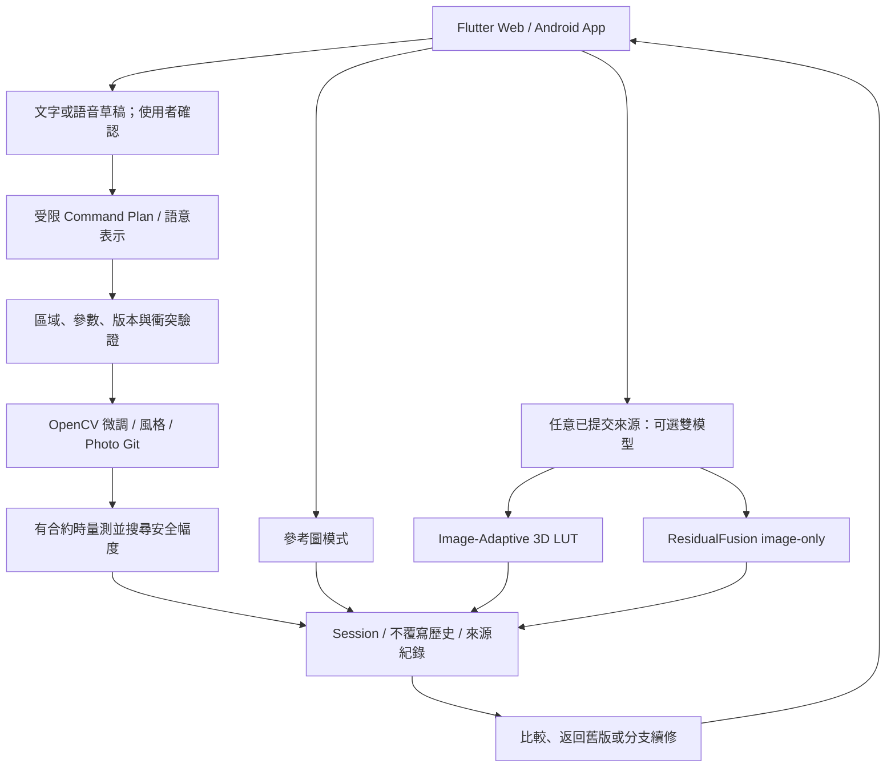

### 受限語意理解與 OpenCV 微調

- **理解與執行分離**：正式主線以 Ollama `llama3.2:3b`、集中式語意 registry、結構化計畫與驗證器理解需求。LLM 不能自行決定最終數值、edit ID 或衝突答案；一般語意解析保留規則 fallback。
- **有界自適應控制**：保存方向、候選值與上下界，反向回饋時縮小調整幅度。相容微調從固定基準與總參數重算，避免每一步都在已處理像素上累積誤差；各分支的控制狀態獨立。
- **區域遮罩**：SegFormer 提供天空、人物遮罩，背景由可靠人物遮罩反相取得；亮部／暗部依亮度分布選取。遮罩快取與邊界柔化兼顧互動速度和一致性。
- **可驗證限制**：修圖合約以影像量測判斷是否滿足保護條件，保存原要求、實際參數與縮幅結果；需求不完整、區域不存在或無安全結果時維持原狀。

### Photo Git 與模型視覺基準

Photo Git 合併的是可追蹤的區域／參數 contribution，不是任意兩張照片的像素混合。它要求可相容的共同基準（anchor），檢查來源及衝突後重算新版本。

每個自動模型結果都是新的、不可拆解的視覺 anchor。只有共用同一個實際 anchor 節點的後代，才能合併其後的相容微調；不同模型、不同執行批次或其他不相容 anchor 不自動合併。雙模型若只成功一個，保留成功版本並顯示另一個錯誤；都失敗則不新增歷史。

### Image-Adaptive 3D LUT

本路線依既有 Image-Adaptive 3D LUT 方法進行現代 PyTorch 實作：輕量 CNN 讀取縮放至 256 × 256 的影像，預測三個 `33 × 33 × 33` 基底 LUT 的權重，再以融合 LUT 對原影像做三線性插值。

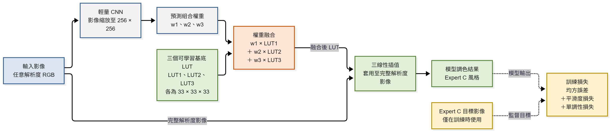

- 以 FiveK 原圖與 Expert C 建立配對，損失結合影像 MSE、平滑度與單調性約束。
- 使用 `grid_sample` 取代舊自訂 CUDA 插值元件，支援 CPU／CUDA。
- 保存資料 manifest、隨機狀態、optimizer 與 checkpoint，分開 public-dev 與 hidden 評估；hidden 不用於訓練或選 checkpoint。
- 方法屬影像自適應的全域色彩映射；獨立局部物件及紋理編輯仍有侷限。

原始方法、工程化範圍與授權詳見 [模型 README](image_adaptive_3dlut/README.md) 及 [第三方來源說明](image_adaptive_3dlut/THIRD_PARTY_NOTICES.md)。

### ResidualFusion

此路線由人工劣化／Oracle 修復研究，發展為 FiveK 原圖與 Expert C 的自然配對監督學習。先以 32 維影像統計特徵及 ridge regression 預測八項全域參數，再用 MobileNetV3 Small 空間編輯器學習局部 RGB 仿射與六色相 HSL 修正。

殘差輸出可寫為 `b + s × (c − b)`：`b` 為基線，`c` 為候選，`s` 為預測強度。後續結合 SegFormer 區域強度、風險判斷、最差樣本退化量及過修控制，降低不必要的調整。

**正式系統只整合其 image-only runtime。** 套件中的 Qwen3-1.7B LoRA／Prompt Controller 是組員文字控制研究的一部分；其舊 LLM、backend、frontend 不取代本專案正式系統。詳見 [ResidualFusion 研究與交付說明](residual_fusion/README.md)。

### 已探索但未採用的路線

早期以 PPO、Teacher／Student 與 OpenCV 操作序列探索逐步調色，因獎勵設計、操作交互影響與過度調整等限制，未作為正式自動模型。相關方法保存於 `archive/failed_methods/`，與現行推論分開。Darktable 已停止推進，亦不列為下一階段開發目標。

## 研究結果與驗證界線

### Image-Adaptive 3D LUT

研究報告記錄 3,935 組訓練、488 組 public-dev、500 組 hidden 配對，完成 400 epochs 訓練；資料前處理包含方向／比例檢查及短邊 480 像素縮放。

| 量測 | 結果 | 解讀 |
| --- | --- | --- |
| public-dev 最佳 PSNR | 22.3318 dB | 模型 README 記錄的最佳結果，僅適用該切分與前處理。 |
| hidden 相對 public-dev 的 PSNR | 降低約 0.4028 dB | 研究報告記錄的泛化落差。 |
| hidden 相對 public-dev 的 SSIM | 降低約 0.00551 | 不同資料切分下仍有差異。 |
| hidden 相對 public-dev 的 Delta E | 增加約 0.5422 | 色差略增；不是主觀美感評分。 |

### ResidualFusion 凍結研究版本

正式研究使用 **4,600 訓練／200 開發／200 最終評估**，訓練集內採五折折外預測。凍結版本的區域強度融合在 200 張 final set 上記錄：

| 指標 | 結果 |
| --- | --- |
| 自訂組合損失的平均改善量（mean gain） | +0.030224 |
| 最差 10% 平均改善量 | −0.041358 |
| 退化率（harm rate） | 15% |
| 嚴重退化率（catastrophic rate） | 11% |
| 實際採用編輯的比例（edit rate） | 78.5% |

來源為 [凍結 final 評估 JSON](residual_fusion/training/outputs/expert_c_continuous_spatial_strength_final002/result.json)。改善量與退化率依該實驗的損失與門檻定義，不等於使用者滿意度；最差 10% 的負值也顯示仍有失敗案例。

**研究評估完成後，展示用區域強度模組另以全部 5,000 組資料重擬合。** 上表不能當成現行展示權重的新獨立泛化成果。兩模型的資料切分與衡量方式不同，也不以表中數字直接排名。

### 系統整合與效能紀錄

Photo Git、修圖合約、多語語音、統一指令調度及雙模型整合已完成各自必要測試與使用者人工驗收；Android 另於 2026-09-20 完成實際安裝及目前功能操作確認。未逐項回報的手機邊界案例仍保留未測。

既有雙模型整合量測中，以 RTX 3070 Ti 8 GB、單張 1536 × 1024 一般人像執行同來源雙模型比較：首次約 **7.18 秒**，暖機後約 **2.28 秒**。SegFormer、Whisper、兩個自動模型與 Ollama `llama3.2:3b` 共存時，觀察到的顯存峰值約 **6,970 / 8,192 MiB**，當次未 OOM；兩模型 CPU fallback 亦已驗證。

以上是特定環境下的整合觀察，不是多照片／多使用者延遲分布、最低硬體規格或所有裝置效能承諾。Expert C 接近度、程式測試與人工功能驗收，分別回答不同問題，不能合併成「全面準確率」。

<a id="run"></a>
## 安裝與執行

以下以 **Windows PowerShell、電腦執行 AI、Web／手機連接同一後端** 為例。一般使用不需要 FiveK 訓練資料或重新訓練模型，也不需要 OpenAI API key。

### 1. 準備工具與程式碼

本工作區已驗證的環境為 Python **3.11.9**、Flutter **3.41.5**／Dart **3.11.3**、Android SDK **36.1.0**、Android Studio JDK **21.0.9**。這是已用環境紀錄，不是任意版本組合的相容性保證。

- 安裝 Git、Python、Flutter 與 Ollama；Android 建置另需 Android SDK／JDK 及接受 SDK 授權。
- 兩個 Flutter 專案的 Dart 約束都是 `^3.11.3`。
- 後端鎖定 `torch==2.11.0+cu128`／`torchvision==0.26.0+cu128`，包含 NVIDIA CUDA 12.8 wheel 來源。GPU 推論需相容驅動；無可用 CUDA 時，兩模型可改用 CPU。若改用其他作業系統或 CPU-only wheel，需另選相容套件並驗證，這份鎖定檔不保證跨平台安裝。

```powershell
git clone https://github.com/WeiChen80percent/AI_photo_editor.git
cd AI_photo_editor
```

請使用含 `backend/`、`frontend/`、`mobile_app/` 的完整版本。若剛完成 clone 的主線尚無 `mobile_app/`，先切至已包含手機及共用啟動腳本的交付分支，再繼續下列步驟：

```powershell
# 僅用於剛 clone、沒有本機修改，且目前版本尚無 mobile_app/ 的情況。
git switch --track origin/feature/mobile-app-cleanup-20260915
```

已有完整手機目錄者略過此步；已有工作內容者應先確認版本與工作樹，再依團隊流程整合。

### 2. 建立正式後端環境

從 repository 根目錄執行；**已有 `backend/.venv` 時沿用，不必重建**。

```powershell
py -3.11 -m venv backend\.venv
.\backend\.venv\Scripts\python.exe -m pip install -r .\backend\requirements.txt
```

後續一律明確使用這個 Python。模型子目錄另有訓練用相依檔，`requirements-mobile.lock.txt` 亦為另一台電腦的快照，不要將多份環境混裝到正式後端。

### 3. 準備模型資產

首次下載需要網路、磁碟空間與等待；下載完成後由本機模型執行推論。

| 模型 | 用途 | 準備方式 |
| --- | --- | --- |
| Ollama `llama3.2:3b` | 正式文字意圖理解 | 先啟動 Ollama，執行下方 pull。 |
| SegFormer B5 | 語意區域遮罩，亦供 ResidualFusion 使用 | 預設只讀本機快取，首次必須先下載。 |
| `openai/whisper-large-v3-turbo` | 語音轉文字 | 第一次使用語音時透過 Transformers 下載，之後使用快取。 |
| WeiChen `best.pt` | Image-Adaptive 3D LUT | 權重不在 Git；下載至 `image_adaptive_3dlut/trained_model/`。 |
| ResidualFusion image-only 資產 | 殘差與區域融合推論 | 必要資產隨 repository 保存；不要另行安裝其舊 Prompt Controller。 |

```powershell
# Ollama 桌面服務已執行時，直接下載模型。
ollama pull llama3.2:3b

# 下載 3D LUT checkpoint。
.\backend\.venv\Scripts\hf.exe download WeiChen80percent/image-adaptive-3dlut best.pt `
  --local-dir .\image_adaptive_3dlut\trained_model

# SegFormer 預設 local-only，先建立本機模型快取。
.\backend\.venv\Scripts\python.exe -c "from transformers import AutoImageProcessor, SegformerForSemanticSegmentation; m='nvidia/segformer-b5-finetuned-ade-640-640'; AutoImageProcessor.from_pretrained(m); SegformerForSemanticSegmentation.from_pretrained(m)"
```

Ollama 尚未執行時，可另開終端執行 `ollama serve`；不要與已啟動的桌面服務重複占用連接埠。若 Hugging Face 模型庫要求授權，先以 `.\backend\.venv\Scripts\hf.exe auth login` 登入。

正式 adapter 會核對模型資產。3D LUT checkpoint 預期 SHA-256 為：

```text
6A1BCB229A67F221851CC1314DF8279354BD807044F523DA5D83B62DB44C58FE
```

取得不同版本時應核對交付版本，不以略過 hash 檢查作為解法。SegFormer 或語音模型下載失敗時，需先修復其快取；一般 `/health` 成功不代表這些模型已能推論。

### 4. 啟動共用後端

從 repository 根目錄執行，保持此視窗開啟：

```powershell
powershell -NoProfile -ExecutionPolicy Bypass `
  -File .\backend\start_backend_mobile.ps1 `
  -PythonPath .\backend\.venv\Scripts\python.exe
```

這支腳本啟動正式 FastAPI，Web／Android 共用；預設監聽 `0.0.0.0:8000`、單 worker，開啟 LLM 並使用 `llama3.2:3b`。明確指定 `-PythonPath`，避免套用腳本原本的根目錄 `.venv` 預設。

另開終端檢查：

```powershell
Invoke-RestMethod http://127.0.0.1:8000/health
Invoke-RestMethod http://127.0.0.1:8000/edit/auto-models/health
```

API 文件位於 [本機 Swagger](http://127.0.0.1:8000/docs)。`/health` 表示服務可回應；雙模型 health 的 ready 表示資產檢查通過，仍應用一次實際操作確認完整推論。

### 5. 啟動 Web

另開終端，從 repository 根目錄進入 `frontend/`：

```powershell
cd frontend
flutter pub get --enforce-lockfile
flutter gen-l10n
flutter run --no-pub -d chrome --dart-define=API_BASE_URL=http://127.0.0.1:8000
```

前端相依套件已列於 `pubspec.yaml`，不需要再逐一 `flutter pub add`。桌面 Chrome 的 localhost 可使用麥克風；從手機瀏覽器連線使用語音時，需要 HTTPS 等符合瀏覽器要求的安全來源。

### 6. 建置與使用 Android App

先在 repository 根目錄準備相依、多語系及 Gradle wrapper：

```powershell
flutter doctor -v
flutter doctor --android-licenses
flutter precache --android
powershell -NoProfile -ExecutionPolicy Bypass -File .\tools\prepare_mobile.ps1
cd mobile_app
flutter build apk --release --no-pub --dart-define=API_BASE_URL=http://192.168.1.100:8000
```

`192.168.1.100` 是示例，請替換成電腦的實體區網 IPv4。APK 產物為：

```text
mobile_app/build/app/outputs/flutter-apk/app-release.apk
```

將 APK 傳到 Android 手機後安裝。現有 release 使用 debug key，只供研究展示；最低 Android API 為 24（Android 7.0），尚未完成商店發布簽章。

日常使用：

1. 電腦與手機連到同一路由器，電腦可用有線、手機使用 Wi-Fi。
2. 啟動 Ollama 與共用後端，保持電腦不睡眠。
3. 開啟已安裝 App，在「更多操作 → 後端連線設定」輸入 `http://電腦區網IPv4:8000` 並測試連線。
4. 選照片開始操作；儲存結果時允許所需相簿權限，錄音時允許麥克風權限。

不需持續插 USB，也不需每次重新建置 APK。App 已保存的網址優先於建置時的 `API_BASE_URL`；電腦 IP 改變時改 App 設定即可。手機上的 `127.0.0.1` 指手機自己，不能用來連電腦。

### 7. iPhone 行動網頁

報告中的部署採 Flutter Web、Windows FastAPI 與 Caddy HTTPS 反向代理，由 iPhone Safari 存取。repository 尚未提供該展示環境可直接套用的 Caddy 設定、網域及憑證；部署時需讓前端與 API 都能以可信 HTTPS 存取，不能只將 Android 的 HTTP 位址照搬給瀏覽器語音流程。

此成果不代表原生 iOS 已完成。原生 App 的建置、簽章、佈建與實機驗收，仍需 macOS／Xcode 環境。

### 常見問題

| 現象 | 檢查方向 |
| --- | --- |
| 電腦可用、手機連不上 | 確認同一路由器、實體 IPv4、後端監聽 `0.0.0.0`，以及私有網路防火牆是否允許對應服務；不要使用 VPN／虛擬網卡 IP。 |
| 換 APK 後仍連舊位址 | App 保存的設定優先；從「後端連線設定」更新。 |
| 人物／天空調整失敗 | 確認 SegFormer 快取及目標是否存在；沒有可靠遮罩時系統不會偷偷改全圖。 |
| 模型工具 unavailable | 查看雙模型 health 與後端錯誤；確認 checkpoint 路徑、hash 及必要資產。 |
| 第一次語音等待很久 | Whisper 首次需下載與載入；先確認網路與後端紀錄。辨識失敗不應改動圖片或歷史。 |
| Android JNI／CMake 找不到實際存在的來源檔 | 本工作區曾遇 Ninja 對含中文 SDK／Pub cache 路徑處理失敗；採英文工作／快取／暫存路徑排查，不盲目重裝整套 SDK。 |
| 想同時接待多人或公開網際網路 | 目前為單使用者本機／區網展示；登入、權限、隔離、資源排程與負載驗證須另行完成。 |

手機匯入目前限定 JPEG／PNG，檢查上限為 40 MiB／24 MP；HEIC／RAW 不在目前支援範圍，也不承諾保留 EXIF、GPS、ICC 或透明度。請保留原始照片。

## 專案結構

```text
AI_photo_editor/
├─ frontend/                  # 正式 Flutter Web
├─ mobile_app/                # 獨立 Flutter Android / iOS 專案；iOS 尚未部署
├─ backend/
│  ├─ app/routes/             # 修圖、版本、風格、雙模型、語音 API
│  ├─ app/services/           # 語意、控制器、OpenCV、遮罩、合約、history、adapter
│  ├─ app/style_catalog/      # 版本化風格及來源資訊
│  ├─ storage/               # 執行時圖片、session、history 與快取，不納入 Git
│  ├─ requirements.txt       # 正式後端相依
│  └─ start_backend_mobile.ps1
├─ image_adaptive_3dlut/      # 3D LUT 訓練、評估與推論；checkpoint 另下載
├─ residual_fusion/           # 模型研究交付；正式系統只取 image-only runtime
├─ archive/failed_methods/    # 歷史方法封存，不是正式系統相依
├─ tools/                    # 手機準備與對等查核工具
└─ docs/                     # 技術文件、手機指南與 README 展示圖片
```

若要擴充語言別名或參數，先讀 [語意擴充指南](docs/semantic_extension_guide.md)；手機工程細節見 [手機 README](docs/mobile/README.md)。子文件保留撰寫當時的環境與驗證範圍，平台最新完成狀態以本頁的「平台狀態」為準。

<a id="future"></a>
## 未來可研究方向

以下均為**尚未完成的候選研究**，不代表已提供的功能或確定交付時程。

| 方向 | 可研究的問題與驗證方式 |
| --- | --- |
| Taste DNA 個人審美 | 從候選選擇、返回舊版及反向微調學習偏好，觀察是否減少修到滿意所需的輪數；提供查看、停用與刪除偏好的控制。 |
| 整組照片一致化 | 同一語意目標依各照片內容選擇不同參數，結合保護條件與異常挑選，衡量一致性及節省的人工步驟。 |
| 可拆解參考圖與文字約束 | 分別學習色溫、亮度、對比等成分，結合指定區域與保護條件；需重新規劃目前文字／參考圖互斥的契約。 |
| 更細選區與遮罩修正 | 人臉、皮膚、頭髮、衣服及指定物件，遮罩顯示與手動增減，評估局部控制及保護可靠度。 |
| 模型穩定性與泛化 | 擴充場景及失敗案例，改善過修風險，分開評估參考接近度與主觀偏好；展示重訓與獨立測試持續分離。 |
| 正式行動部署與多人服務 | 原生 iOS、跨裝置相簿／權限／恢復驗證，以及登入、資料隔離、資源排程與多人負載量測。 |
| 硬體友善推論 | 比較量化、CPU／GPU 卸載的延遲、RAM／VRAM 與下游意圖一致性；依 profiling 再選擇值得研究的算子或加速器。 |
| 可追責說明與反事實預覽 | 依既有 history、參數及量測回答「哪一步造成變化」「再亮是否過曝」，評估說明正確性及決策幫助。 |

尚未完成 FPGA／RTL／HLS 加速器或手機端離線模型部署。降噪、裁切、透視校正等基本工具可另行補強；生成式物件移除、換背景、擴圖與完整 RAW／HDR 管線不屬目前主線。

## 團隊與成果歸屬

依團隊研究報告整理主要分工；三人共同參與計畫、成果報告及其他文書。

| 成員 | 主要工作 |
| --- | --- |
| 李瑋宸（WeiChen） | 早期 LLM／OpenCV 強化學習探索、Image-Adaptive 3D LUT 實作與訓練、Web 邏輯移植手機 App。 |
| 柯伯諺 | 正式系統前端、後端功能、前後端串接與測試，以及模型整合。 |
| 楊鎧榤（Kai） | 人工劣化資料及 Oracle 驗證、Qwen3 LoRA 研究、ResidualFusion 開發訓練評估、區域融合與過修控制、iPhone 行動網頁串接與實機驗證。 |

模型研究沿用相關論文與預訓練模型；本頁將方法來源、組員訓練成果與正式系統整合分開描述。FiveK 原始資料不隨 repository 分發，使用資料、權重與第三方元件時應遵守各自授權。

## 來源與延伸閱讀

- 團隊《完整專題研究報告》：研究方法、資料切分、平台結果、分工與本頁 15 張圖片的來源。Word 原件未隨本次 README 更新加入 repository。
- [Image-Adaptive 3D LUT](image_adaptive_3dlut/README.md)：方法、訓練、checkpoint 與 CLI。
- [3D LUT 第三方來源與授權](image_adaptive_3dlut/THIRD_PARTY_NOTICES.md)。
- [ResidualFusion](residual_fusion/README.md)：研究演進、凍結評估與展示版本界線。
- [ResidualFusion final 評估原始數據](residual_fusion/training/outputs/expert_c_continuous_spatial_strength_final002/result.json)。
- [語意擴充指南](docs/semantic_extension_guide.md)：registry、schema 與新增語意能力。
- [手機工程與操作文件](docs/mobile/README.md)／[組員 2026-09-14 測試紀錄](docs/mobile/TEST_REPORT.md)：歷史工程驗證，不等同所有裝置與邊界案例均已通過。

README 圖片保存於 `docs/assets/readme/`，由報告內嵌原圖直接取出並改用可讀檔名，未重新生成或修改影像內容。
